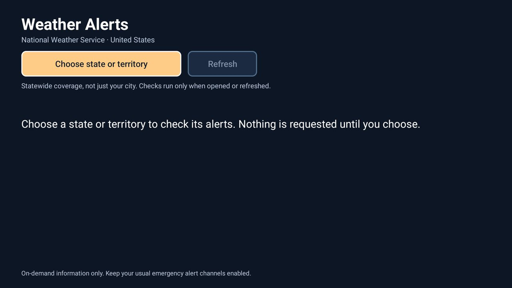

# Weather Alerts

An optional US National Weather Service alert viewer for Android TV 8.0 or newer. Choose a state or
territory with the remote, then open an alert to read its affected areas, expiry, description and
instructions. The selected area stays on the TV. No location is chosen on first launch.

This is a first, US-only part of the idea in [#1635](https://github.com/Gathin23/cleanyourtv/issues/1635).
It uses NWS GeoJSON rather than a general CAP/RSS reader. Other countries and providers are not supported.

## Use

- Open **Weather Alerts** and choose a state or territory. Back/Cancel leaves the choice unchanged.
- Left/Right moves between the area and Refresh buttons. Down reaches the alerts; Up from the first
  alert returns to Refresh. OK opens the full bulletin. Scroll with Up/Down; Back closes it.
- It checks when opened and when Refresh is pressed. It does not monitor in the background, make
  sounds, show overlays or interrupt playback. It is supplementary information, not an emergency
  notification system; keep the emergency alert channels you normally use enabled.
- Coverage is the **whole selected state/territory**, not the TV's city or an exact address.
- A successful empty response says no active alerts were returned **at the last check**. An outage
  or malformed/incomplete response shows a failure, never a successful zero-alert result. After a
  failed refresh, any previous results remain explicitly labelled with their last check time.
- Expired, cancelled, test and future-effective bulletins are excluded when a response is parsed.
  Details warn if a displayed bulletin expired since that check. Most severe alerts sort first;
  the screen lists up to 100 and says when more were returned.

The app declares a [module card](../../docs/modules.md) and a normal TV app entry. Its card is static:
it opens the viewer; it does not put a live alert count or warning badge on Home. CleanYourTV asks
before showing a module card. Other launchers can use the normal app entry.

## Build and install

With JDK 17 and Android SDK 34, from this directory:

```sh
./gradlew --no-daemon testReleaseUnitTest lintRelease assembleRelease
```

On Windows use `gradlew.bat`. Install `app/build/outputs/apk/release/app-release.apk` with the
repository's [add-on instructions](../README.md#how-an-add-on-works). The application ID is
`com.dvopenlabs.weatheralerts`; it has no Home intent filter and does not replace a launcher.
Release builds use the local Android debug signing key for sideloading, like the other add-ons.
There are no runtime third-party dependencies; JUnit and org.json are used only for JVM tests.

## Permissions and network

- `INTERNET`: HTTPS to `api.weather.gov` for alerts in the state/territory you select. The request
  includes its two-letter code and an app User-Agent. NWS sees the TV's public network address.
  See the [NWS API documentation](https://www.weather.gov/documentation/services-web-api).
- No location, account, Bluetooth, notification, accessibility or overlay permission. No service,
  boot receiver, scheduled polling, analytics, advertising or paid API.
- Requests have connection/read timeouts, a 4 MiB response limit and same-host HTTPS-only redirects.
  Leaving the screen cancels its request. Late results from a previous area or opening are ignored.
  Responses with a next page are treated as incomplete rather than silently dropping warnings.
- The selected state is stored in private app preferences with Android backup disabled. Alert
  results stay in memory only and are discarded when the process ends. No data is logged by the app.

## Screenshot and testing



Device validation is recorded in the pull request. JVM tests cover empty/error feeds, active times,
test/cancel filtering, ordering, duplicate IDs, nullable fields, pagination, bounded text and area
validation. The launcher core is unchanged.
